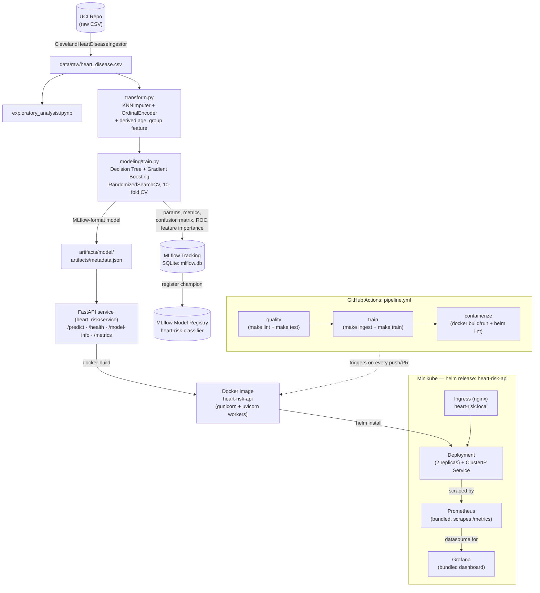

# Heart Risk Prediction — End-to-End MLOps Pipeline

**Course:** AIMLCZG523 (MLOps) — Assignment 1, BITS Pilani
**Author:** Surbhi Arya (2025AE05688)

An end-to-end pipeline — ingest -> engineer features -> train & track ->
package -> test -> containerize -> deploy -> monitor — for a binary
classifier predicting heart disease risk from patient vitals, built on
the [UCI Cleveland Heart Disease dataset](https://archive.ics.uci.edu/ml/machine-learning-databases/heart-disease/processed.cleveland.data).

**Contents:** [Architecture](#architecture) · [Repository Layout](#repository-layout) ·
[Getting Started](#getting-started) · [Running the Service](#running-the-service) ·
[Observability](#observability) · [Continuous Integration](#continuous-integration) ·
[Results](#results)

---

## Architecture



---

## Repository Layout

```
.
├── data/raw/                 # heart_disease.csv (ingested, gitignored)
├── notebooks/
│   └── exploratory_analysis.ipynb
├── docs/
│   ├── figures/
│   └── report.md
├── heart_risk/                # main package
│   ├── ingestion.py            # ClevelandHeartDiseaseIngestor (class-based)
│   ├── dataset.py               # load/split helpers
│   ├── transform.py             # KNNImputer + OrdinalEncoder + age_group
│   ├── modeling/
│   │   ├── train.py              # RandomizedSearchCV, MLflow (SQLite + registry)
│   │   ├── metrics.py            # metrics + confusion/ROC/feature-importance plots
│   │   └── inference.py          # RiskPredictor (loads MLflow-format model)
│   └── service/
│       ├── app.py                 # FastAPI app, JSON logging, Prometheus
│       └── contracts.py           # Pydantic request/response models
├── tests/                      # unittest.TestCase suite (41 tests)
├── deploy/
│   ├── docker/
│   │   ├── Dockerfile             # multi-stage, Python 3.12, gunicorn+uvicorn
│   │   └── requirements.txt       # slim runtime deps (mlflow-skinny)
│   └── helm/heart-risk-api/       # Helm chart (API + Ingress + Prometheus + Grafana)
├── .github/workflows/pipeline.yml
├── screenshots/
├── Makefile                    # install/lint/test/ingest/train/serve/docker/helm targets
└── requirements.txt             # full dev environment
```

---

## Getting Started

### Environment setup

```bash
python3.12 -m venv .venv
source .venv/bin/activate
make install
```

### Data ingestion

```bash
make ingest
# -> data/raw/heart_disease.csv (303 rows, 14 columns)
```

Implemented as `ClevelandHeartDiseaseIngestor` (`heart_risk/ingestion.py`) —
a small class rather than a script, so a notebook/test can point it at a
different source URL without touching module-level globals. Not committed
to git (only re-fetched on demand); fails with a clear message if UCI is
unreachable.

### Exploratory analysis

```bash
jupyter notebook notebooks/exploratory_analysis.ipynb
```

Already executed with saved outputs (KDE plots, stacked proportion bars,
correlation heatmap — exported to `docs/figures/` too).

### Model training & tracking

```bash
make train
```

Trains a **Decision Tree** and a **Gradient Boosting** ensemble, each
tuned via `RandomizedSearchCV` (10-fold stratified CV, 20 sampled
candidates, scored on **F1**). Every run logs params/metrics/confusion
matrix/ROC curve/feature-importance plot to MLflow (SQLite-backed store:
`mlflow.db`), and the champion is **registered in the MLflow Model
Registry** (`heart-risk-classifier`) in addition to being saved as an
MLflow-format model directory at `artifacts/model/`.

```bash
mlflow ui --backend-store-uri sqlite:///mlflow.db
```

---

## Running the Service

### Local development

```bash
make serve
# or: uvicorn heart_risk.service.app:app --reload --port 8080
```

```bash
curl http://localhost:8080/health
curl http://localhost:8080/model-info

curl -X POST http://localhost:8080/predict \
  -H "Content-Type: application/json" \
  -d '{"age":58,"sex":1,"cp":2,"trestbps":140,"chol":211,"fbs":0,
       "restecg":0,"thalach":165,"exang":0,"oldpeak":0.0,"slope":1,
       "ca":0,"thal":3}'
```

Interactive docs: http://localhost:8080/docs

### Automated tests

```bash
make lint   # flake8
make test   # unittest, 41 tests, ~4s, no network needed
```

### Docker

```bash
make docker-build
make docker-run
curl http://localhost:8080/health
docker rm -f heart-risk-api
```

`artifacts/model/` + `artifacts/metadata.json` must exist first (run
`make train`). The image runs via **gunicorn managing uvicorn workers**
rather than uvicorn directly, and uses `mlflow-skinny` (not full
`mlflow`) to keep the serving image lean while still supporting the
MLflow model format.

### Kubernetes (Helm)

```bash
minikube start --driver=docker --cpus=2 --memory=4000
minikube addons enable ingress

eval $(minikube docker-env)
make docker-build
eval $(minikube docker-env -u)

helm install heart-risk-api deploy/helm/heart-risk-api \
  --namespace heart-risk --create-namespace

kubectl -n heart-risk get pods -w
```

Add `heart-risk.local` to `/etc/hosts` pointing at `minikube ip`, or use
`minikube tunnel` (Docker driver), then:
```bash
curl http://heart-risk.local/health
```

A single `helm install` brings up the API Deployment, its Ingress, **and**
the bundled Prometheus + Grafana — no separate `kubectl apply` steps.

---

## Observability

```bash
minikube service heart-risk-api-prometheus -n heart-risk --url
minikube service heart-risk-api-grafana -n heart-risk --url   # admin/admin
```

Grafana auto-provisions a Prometheus datasource and a
**"Heart Risk API — Service Health"** dashboard: predictions-by-label
over time, a requests-per-route pie chart, average vs. p99 latency, and
an error-rate gauge.

---

## Continuous Integration

`.github/workflows/pipeline.yml` — three Makefile-driven stages:

| Stage | Command | Fails the pipeline if... |
|---|---|---|
| `quality` | `make lint`, `make test` | lint errors or any unit test fails |
| `train` | `make ingest`, `make train` | training errors or `artifacts/metadata.json` missing |
| `containerize` | `make docker-build/run`, `make helm-lint` | container never becomes healthy, bad `/predict` response, or invalid Helm chart |

---

## Results

| Model | CV F1 (10-fold) | Holdout Accuracy | Holdout Precision | Holdout Recall | Holdout F1 | Holdout ROC-AUC |
|---|---|---|---|---|---|---|
| **Gradient Boosting (champion)** | 0.799 | 0.820 | 0.870 | 0.714 | **0.784** | **0.939** |
| Decision Tree | 0.736 | 0.803 | 0.833 | 0.714 | 0.769 | 0.917 |

See `docs/report.md` for the full write-up (EDA discussion, modelling
choices, architecture diagram, CI/CD + deployment screenshots).
