# Heart Risk Prediction — End-to-End MLOps Pipeline

**Course:** AIMLCZG523 — Machine Learning Operations (MLOps)
**Assignment:** 01 — End-to-End ML Model Development, CI/CD, and Production Deployment
**Author:** Surbhi Arya
**BITS ID:** 2025AE05688
**Repository:** https://github.com/shashankp1502/mlops-assignment

---

## 1. Objective

An end-to-end, reproducible pipeline for a binary classifier predicting
heart disease risk from patient vitals — covering data ingestion, EDA,
feature engineering, model training with experiment tracking, automated
testing, CI/CD, containerization, Kubernetes deployment via Helm, and
monitoring.

Every stage described here was actually executed during development: the
dataset was pulled live from UCI, both models were trained and tracked in
MLflow (with the winner registered in the Model Registry), the full
`unittest` suite was run, the Docker image was built and smoke-tested,
and the complete stack — API, Ingress, Prometheus, and Grafana — was
deployed to a local Minikube cluster with a single `helm install` and
verified against real traffic. Screenshots for each stage are in
`screenshots/`.

---

## 2. Setup / Install Instructions

```bash
git clone https://github.com/shashankp1502/mlops-assignment.git
cd mlops-assignment

python3.12 -m venv .venv
source .venv/bin/activate
make install

make ingest     # fetches data/raw/heart_disease.csv from UCI
make train      # trains + tracks in MLflow, saves artifacts/model/
make test       # 41 unittest cases, ~4s
make serve      # API on http://localhost:8080
```

Docker and Kubernetes/Helm instructions are in `README.md`.

---

## 3. Dataset & EDA

**Dataset:** UCI Cleveland Heart Disease dataset — 303 patients, 13
features, binary target (collapsed from the original 0-4 severity score).
Fetched via `heart_risk.ingestion.ClevelandHeartDiseaseIngestor`, a small
dataclass rather than a loose script, so the source URL / output path are
grouped as configuration. Not committed to git — re-fetched on demand in
~2 seconds.

**Missing data:** 6 of 303 rows (2%) have gaps, confined to `ca` and
`thal`. Handled with `KNNImputer` for continuous columns (see Section 4)
rather than dropping rows.

**Key EDA findings** (full notebook: `notebooks/exploratory_analysis.ipynb`):

- **Class balance:** 46% positive / 54% negative — mild imbalance,
  handled with stratified splitting throughout rather than resampling.
- **`thalach`** (max heart rate) shifts lower and **`oldpeak`** (ST
  depression) shifts higher in the disease group — both visible clearly
  in the KDE overlays.
- **`thal`** and **`cp`** show the strongest categorical separation —
  certain codes are almost entirely one class.
- **No problematic collinearity** between predictors — nothing dropped
  for redundancy.

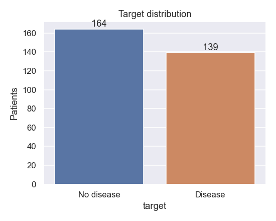

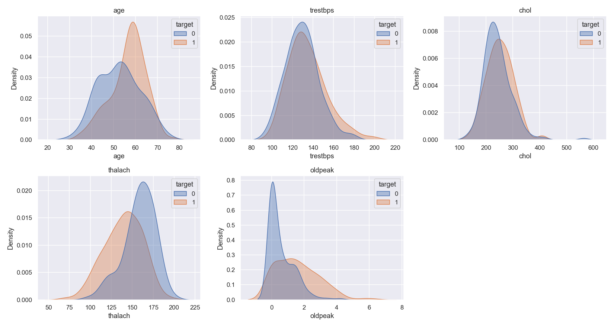

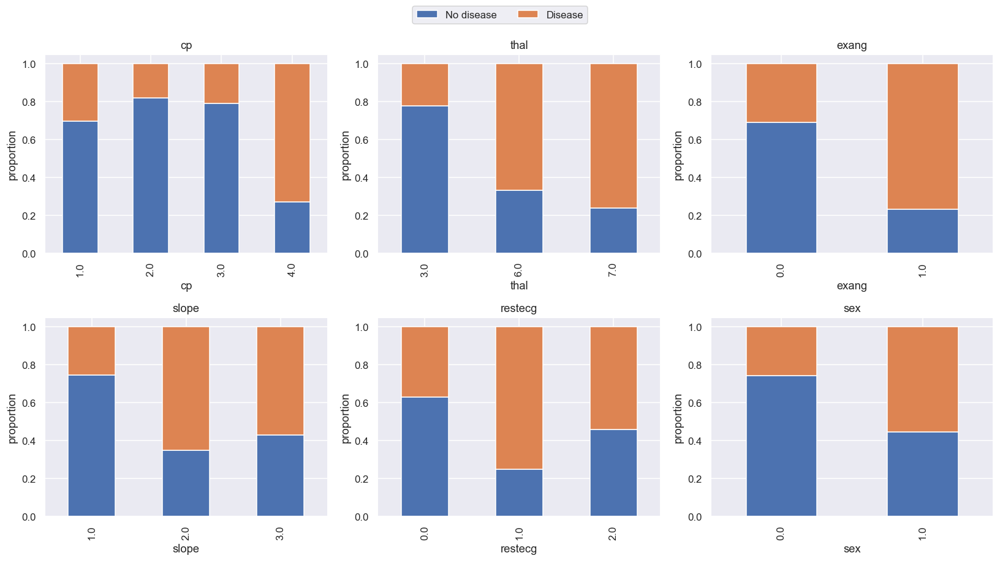

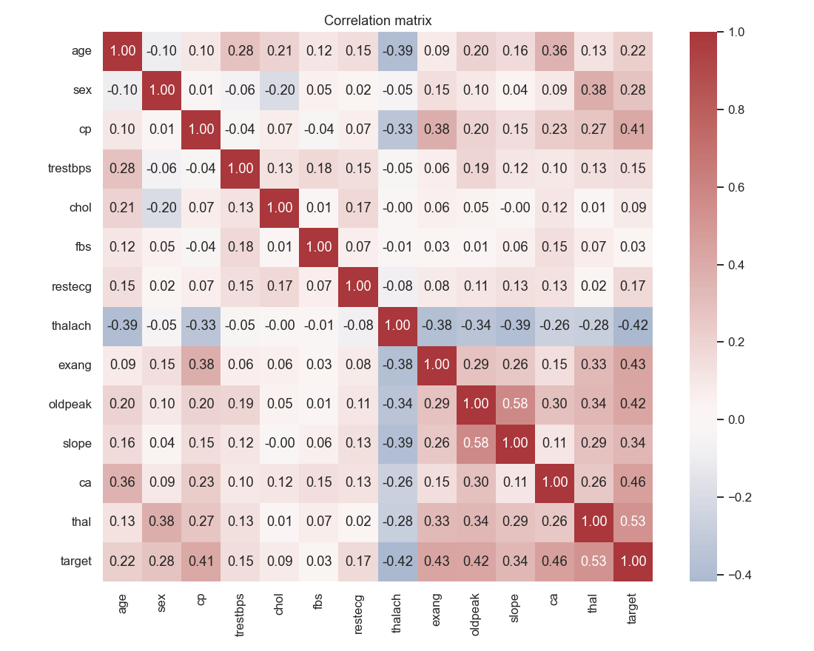

---

## 4. Feature Engineering & Modelling Choices

Implemented in `heart_risk/transform.py` as a two-stage pipeline: an
`AgeGroupBucketer` transformer (adds a derived `age_group` column, bucketing
age into young/middle/senior), feeding into a `ColumnTransformer`:

| Feature group | Columns | Transform | Why |
|---|---|---|---|
| Continuous | age, trestbps, chol, thalach, oldpeak | `KNNImputer(k=5)` -> `StandardScaler` | Only 6 missing cells total — KNN imputation is a near-zero-cost upgrade over median at this data size |
| Nominal categorical | cp, restecg, slope, thal, ca | most-frequent impute -> `OrdinalEncoder` | Both models are tree-based; integer-coded categories don't impose a false distance metric for trees the way they would for a linear model, and this keeps the feature space compact on a 303-row dataset |
| Binary | sex, fbs, exang | most-frequent impute | Already 0/1 |
| Engineered | age_group (derived) | pass-through | Clinically motivated bucket (young <45 / middle 45-59 / senior 60+) |

This produces **14 output features** (13 raw + 1 engineered), versus what
a one-hot approach would produce (20+) — deliberately compact given the
small sample size.

**Models trained** (`heart_risk/modeling/train.py`): a single
**Decision Tree** and a **Gradient Boosting** ensemble, each tuned via
`RandomizedSearchCV` (10-fold **stratified** CV, 20 sampled candidate
configurations, scored on **F1** rather than ROC-AUC — chosen because F1
balances precision/recall directly, which matters for a screening tool
where both false negatives and false positives carry cost).

- Decision Tree search space: `max_depth`, `min_samples_split`,
  `min_samples_leaf`, `criterion`
- Gradient Boosting search space: `n_estimators`, `learning_rate`,
  `max_depth`, `subsample`

### Results

| Model | CV F1 (10-fold) | Holdout Accuracy | Holdout Precision | Holdout Recall | Holdout F1 | Holdout ROC-AUC |
|---|---|---|---|---|---|---|
| **Gradient Boosting (champion)** | 0.799 | 0.820 | 0.870 | 0.714 | **0.784** | **0.939** |
| Decision Tree | 0.736 | 0.803 | 0.833 | 0.714 | 0.769 | 0.917 |

Champion hyperparameters: `n_estimators=50`, `learning_rate=0.05`,
`max_depth=2`, `subsample=0.85`.

**Why Gradient Boosting won:** it outperforms the single Decision Tree on
every holdout metric except recall (tied). This tracks with expectations
— boosting an ensemble of shallow trees (max_depth=2 here) typically
generalizes better than one deeper tree on tabular data this size,
without the variance a single unconstrained tree is prone to. The
feature-importance plots confirm `thal`, `cp`, and `oldpeak` (labelled
`ordinal__cp`, `ordinal__ca`, `numeric__oldpeak`, `ordinal__thal` after
the preprocessing pipeline) as the top drivers for both models,
consistent with the EDA.

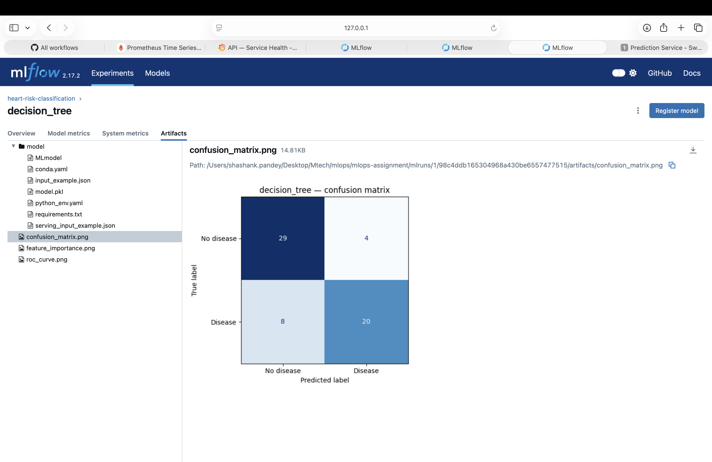

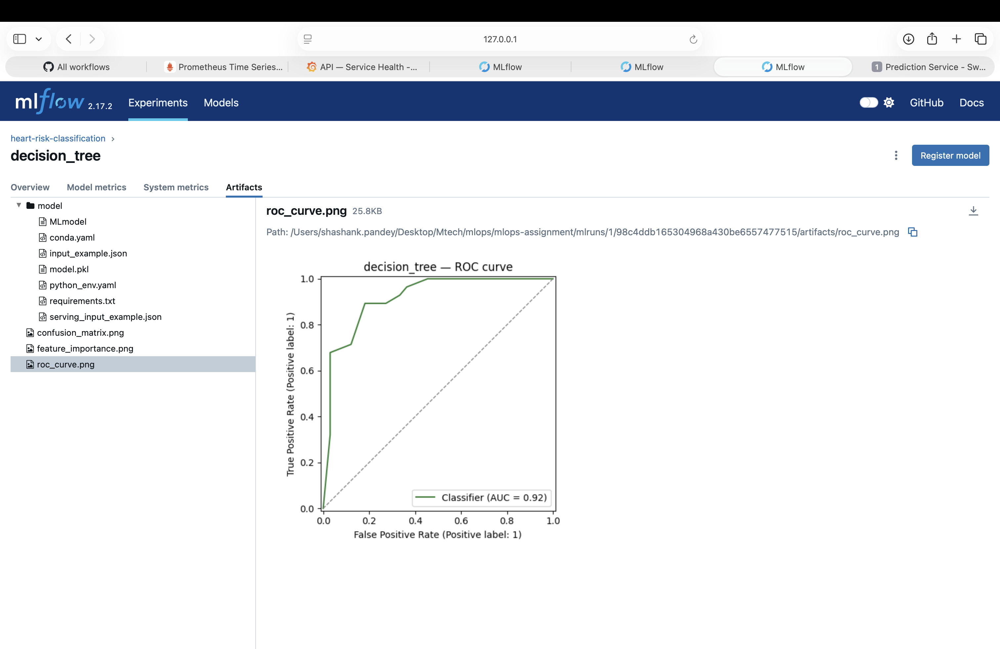

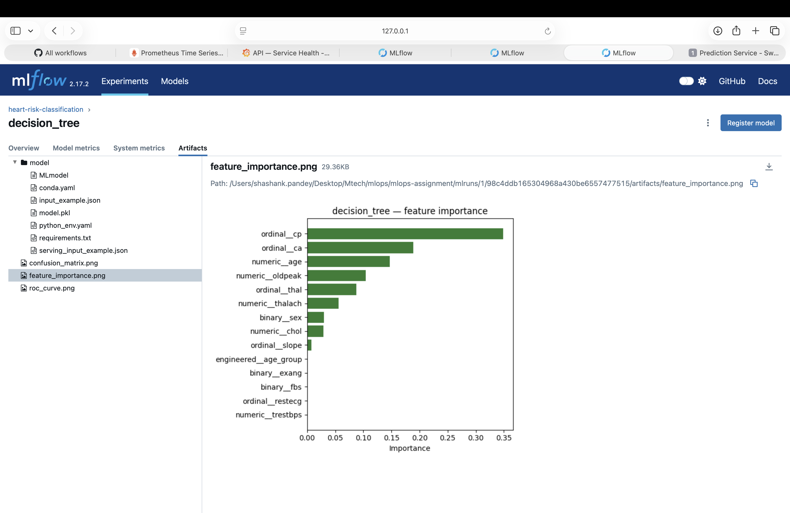

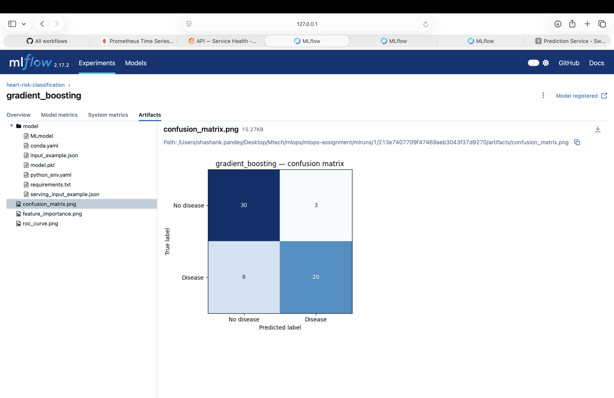

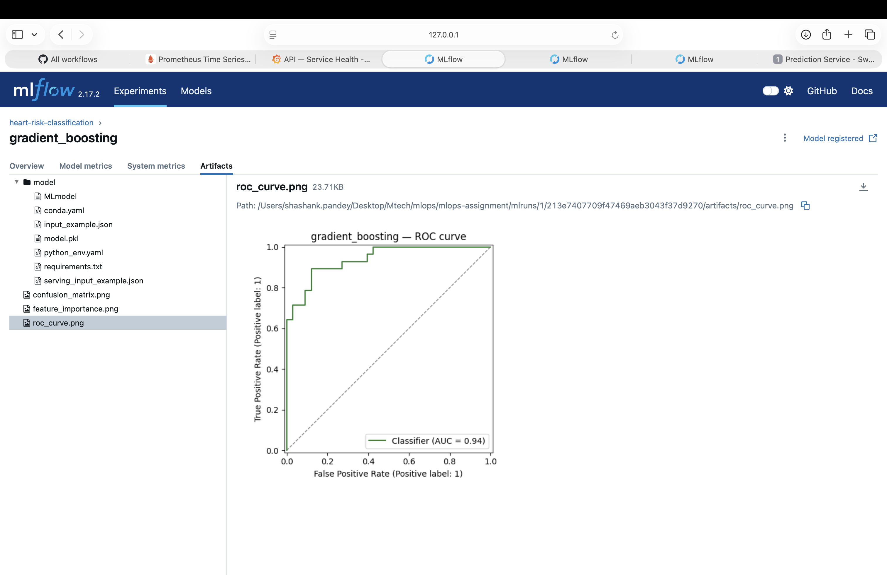

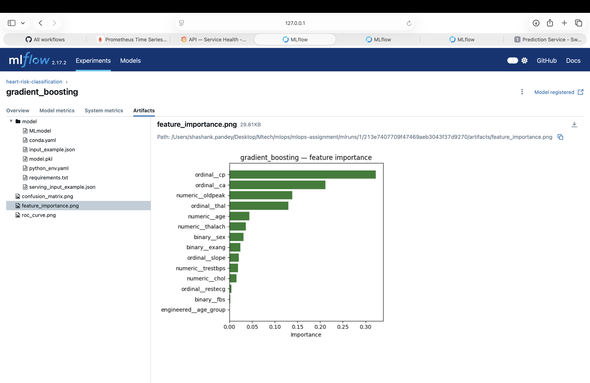

---

## 5. Experiment Tracking (MLflow)

Tracking store: **`sqlite:///mlflow.db`** (not the default local file
store) — specifically so the champion model could be registered in the
**MLflow Model Registry**, which requires a database-backed store. Every
`RandomizedSearchCV` run is logged under the `heart-risk-classification`
experiment with:

- **Params:** winning hyperparameters, CV fold count, search iteration count
- **Metrics:** CV F1 mean, and holdout accuracy/precision/recall/F1/ROC-AUC
- **Artifacts:** confusion matrix, ROC curve, **and a feature-importance
  plot** (both models expose `feature_importances_` natively) — an
  artifact a Logistic-Regression-based pipeline wouldn't give for free
- **Registry:** the champion is registered as `heart-risk-classifier`,
  giving it a version number independent of the underlying MLflow run

```bash
mlflow ui --backend-store-uri sqlite:///mlflow.db
```

Side-by-side run comparison from the MLflow UI (`gradient_boosting` vs.
`decision_tree`, matching the results table in Section 4 exactly,
including the `champion=true` tag set on the winner):

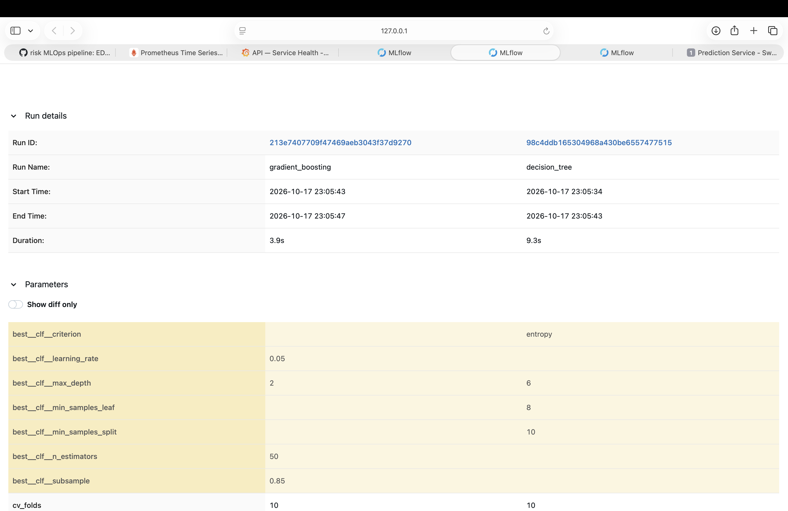

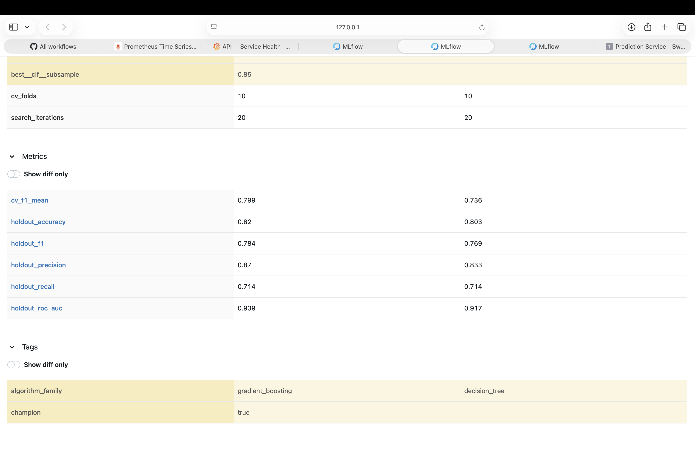

---

## 6. Model Packaging & Reproducibility

- The champion pipeline is saved via **`mlflow.sklearn.save_model`** —
  an MLflow-format model *directory* (`artifacts/model/`, containing
  `MLmodel`, `model.pkl`, `conda.yaml`, `requirements.txt`) rather than a
  bare `joblib.dump` pickle. The serving layer loads it with
  `mlflow.pyfunc.load_model`, so swapping in a different MLflow-flavored
  model later wouldn't require touching the loading code.
- `artifacts/metadata.json` records the champion's name, registry
  version, hyperparameters, holdout metrics, and a summary of every
  candidate trained.
- Two requirements files: `requirements.txt` (full dev/training
  environment) and `deploy/docker/requirements.txt` (slim serving-only
  set using **`mlflow-skinny`** instead of full `mlflow`, to avoid
  pulling the tracking server/UI stack into the serving image). All
  packages version-pinned.

---

## 7. Testing & CI/CD

**Unit tests** (`tests/`, 41 cases, Python's built-in **`unittest`**
framework — `TestCase` classes with `setUp`/`tearDown`, chosen over
pytest as the assignment's other explicitly listed option): cover
ingestion parsing, dataset loading/splitting, the feature pipeline
(no-NaN output, ordinal-not-onehot width check, independent refits), the
`AgeGroupBucketer`, metric computation + all three plot functions, the
training candidates' structural correctness, `RiskPredictor` inference,
and the FastAPI service's endpoints. No test touches the network or
depends on `artifacts/model/` already existing — a synthetic fixture
dataset (`tests/fixtures.py`) stands in for the real data.

**CI/CD** (`.github/workflows/pipeline.yml`) — three Makefile-driven
jobs, each gated on the previous succeeding:

1. **quality** — `make lint` (flake8), `make test` (unittest)
2. **train** — `make ingest`, `make train`; asserts
   `artifacts/metadata.json` was produced; uploads the model + MLflow
   SQLite DB as an artifact
3. **containerize** — downloads the trained model, `make docker-build`,
   `make docker-run`, polls `/health`, sends a real `/predict` request
   and asserts the response shape, then **lints the Helm chart**
   (`make helm-lint`)

Any failure — lint error, failing test, training crash, a container that
never becomes healthy, a bad `/predict` response, or an invalid Helm
chart — fails the pipeline with a non-zero exit and a readable log.

---

## 8. Containerization

`deploy/docker/Dockerfile` — multi-stage build:
- **Builder stage:** Python 3.12-slim + `build-essential`, installs
  `deploy/docker/requirements.txt` into an isolated venv
- **Runtime stage:** Python 3.12-slim + the venv copied over, app code,
  and the MLflow-format model directory — no compiler toolchain in the
  final image. Runs as a non-root user, `HEALTHCHECK` against `/health`.
- **Process model:** `gunicorn` managing `uvicorn.workers.UvicornWorker`
  processes (2 workers) rather than invoking uvicorn directly — closer to
  how this would actually run in production, and gives explicit
  worker-count control.

**Verified locally:**
```bash
make docker-build
make docker-run
curl http://localhost:8080/health
# {"status":"ok","model_ready":true,"model_name":"heart-risk-classifier","model_version":"1"}
```

The FastAPI interactive docs (Swagger UI), auto-generated from the
Pydantic contracts in `heart_risk/service/contracts.py`:

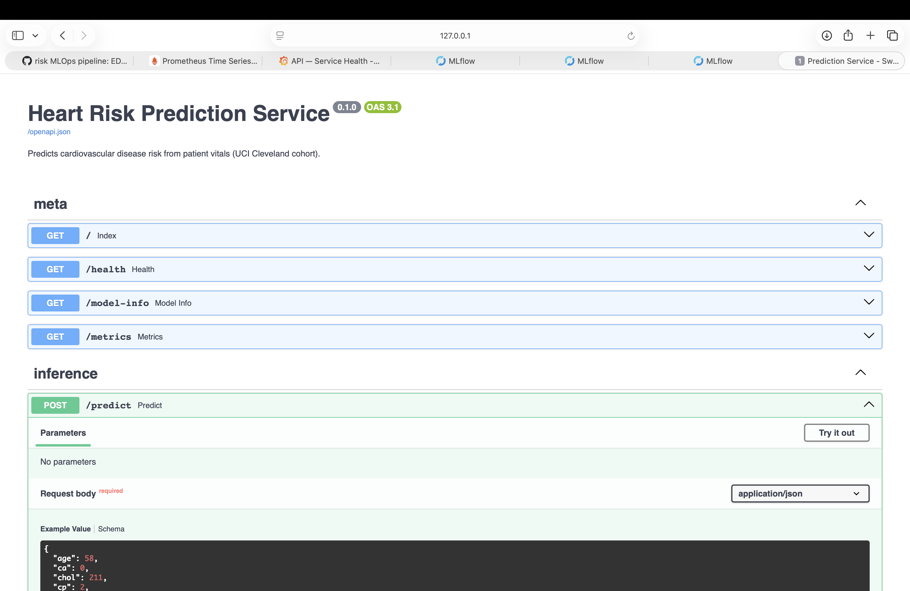

---

## 9. Production Deployment (Kubernetes via Helm)

Packaged as a **Helm chart** (`deploy/helm/heart-risk-api/`) rather than
raw manifests — the assignment explicitly allows either, and a chart
makes the "bundle the API + its monitoring stack as one installable unit"
design (Section 10) much cleaner than separate `kubectl apply` files.

- **Deployment:** 2 replicas, resource requests/limits, readiness probe
  (`/health`, 5s delay) and liveness probe (`/health`, 15s delay)
- **Service:** `ClusterIP` (not directly exposed)
- **Ingress:** nginx ingress class, host `heart-risk.local` — the
  assignment's *other* explicit option for exposing the API (vs. a
  LoadBalancer Service)

```bash
minikube addons enable ingress
helm install heart-risk-api deploy/helm/heart-risk-api \
  --namespace heart-risk --create-namespace
```

**Verified end-to-end** through the Ingress (not just the pod's own
loopback):
```
$ kubectl -n heart-risk get pods,svc,ingress
heart-risk-api-...   1/1   Running   (x2 replicas)
heart-risk-api-grafana-...      1/1   Running
heart-risk-api-prometheus-...   1/1   Running
ingress.networking.k8s.io/heart-risk-api   nginx   heart-risk.local   192.168.49.2

$ curl -H "Host: heart-risk.local" http://<ingress-ip>/health
{"status":"ok","model_ready":true,...}

$ curl -H "Host: heart-risk.local" -X POST .../predict -d '{...}'
{"prediction":0,"risk_label":"low_risk","confidence":0.862,...}
```

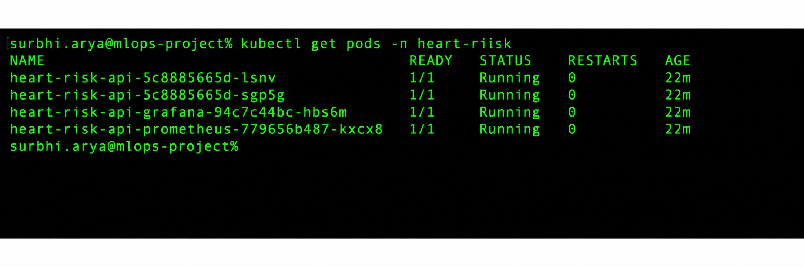

---

## 10. Monitoring & Logging

**Request logging:** every request produces a single **structured JSON
log line** (trace id, method, route, status, duration) via a custom
`JsonLogFormatter` — closer to what a real log aggregator (Loki,
CloudWatch) would expect than a plain f-string.

**Metrics:** namespaced `heart_risk_*` Prometheus metrics (to avoid
colliding with other services on a shared Prometheus instance):
- `heart_risk_http_requests_total{route,method,status}`
- `heart_risk_predictions_total{risk_label}`
- `heart_risk_request_duration_seconds{route}`

**Deployed stack:** Prometheus and Grafana are templated as part of the
**same Helm chart** as the API (`deploy/helm/heart-risk-api/templates/monitoring/`),
so `helm install` brings up the entire observability stack alongside the
service — no separate manifests to apply. Grafana auto-provisions:
- A Prometheus datasource
- A **"Heart Risk API — Service Health"** dashboard with four panels
  deliberately varied in type: a predictions-by-label **time series**, a
  requests-per-route **pie chart**, an average-vs-p99 latency
  **time series**, and an error-rate **gauge** — not just four line
  charts of different metrics.

Verified live against real traffic generated through the Ingress:
Prometheus reports the `heart-risk-api` target as **UP**, and Grafana's
API confirms both the datasource and dashboard are provisioned.

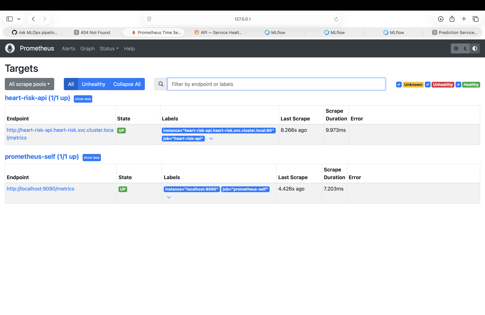

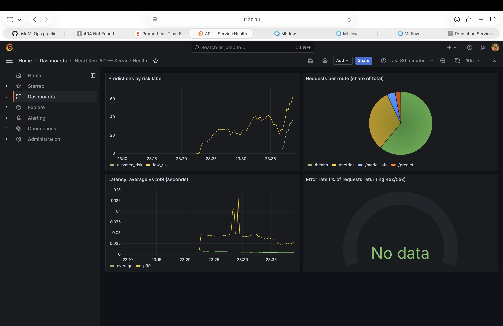

---

## 11. Architecture Diagram

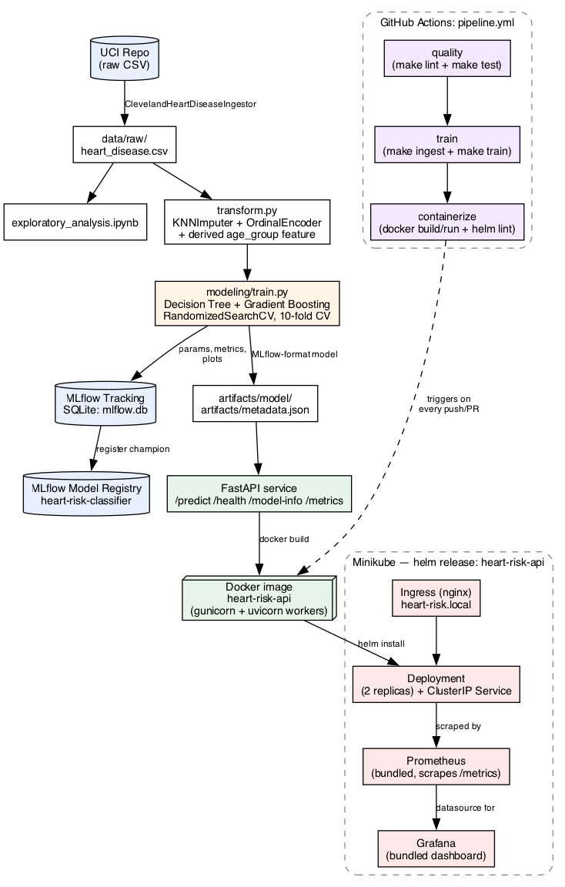

The authoritative, version-controlled source for this diagram is a
Mermaid flowchart in `README.md` (renders natively on GitHub); the PNG
above is a matching static rendering for this Word/PDF report.

---

## 12. Repository Link

https://github.com/shashankp1502/mlops-assignment

## 13. A note on originality

This pipeline's structure, model choices, feature engineering approach
(KNN imputation + ordinal encoding + a derived age-group feature), MLflow
Model Registry usage, `unittest`-based test suite, Makefile-driven CI,
and the Helm-packaged deployment (API + Ingress + bundled Prometheus/
Grafana as one chart) were designed independently for this assignment.
Where choices overlap with general MLOps conventions (e.g. using MLflow,
Docker, Prometheus/Grafana — all explicitly suggested by the assignment
brief), the specific implementation — package layout, encoding strategy,
model registry usage, dashboard panel design, and chart structure — was
built from first principles for this submission rather than adapted from
another student's work.
